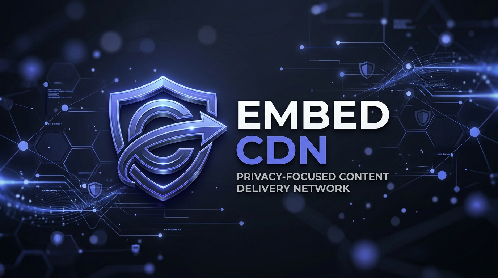

# <div align="center">🛡️ EmbedCDN</div>

<p align="center">
  <strong>A privacy-focused Content Delivery Network designed to beautifully embed images on Discord while retaining full data ownership.</strong>
</p>

<p align="center">
  
  
  
  
</p>

<div align="center">
  
</div>

<br />

<p align="center">
  <a href="https://cdn.api.sonu-kumar.in/">🚀 Live Demo</a>
  •
  <a href="https://github.com/notysozu/EmbedCDN/issues">🐛 Report Bug</a>
  •
  <a href="https://github.com/notysozu/EmbedCDN/issues">✨ Request Feature</a>
</p>

---

## 📖 Description

**EmbedCDN** is a privacy-first, self-hosted Content Delivery Network (CDN) engineered specifically for Discord users who want absolute ownership of their shared files and images. In standard Discord workflows, uploaded images are cached permanently by Discord's media proxy servers, meaning they often persist online even after you delete the message containing them. EmbedCDN solves this issue by serving images on-demand through dynamically generated Open Graph metadata.

When you share an EmbedCDN link, Discord’s crawlers request the image to generate a rich embed preview. By managing the serving layer, EmbedCDN allows you to instantly revoke access to any image. When deleted from your EmbedCDN dashboard, the dynamic Open Graph tags are immediately destroyed, rendering the media completely inaccessible and clearing it from Discord clients in real-time. It serves as a secure, personal data kill-switch for all your shared media.

---

## ⚡ Key Features

* **🔒 Privacy-First Design**: Retain absolute ownership of your data. Files are hosted on your infrastructure, not on opaque third-party servers.
* **🔗 Custom Short Links**: Automatically generates sleek, customized short links for every uploaded image.
* **🛑 Instant Embed Deletion**: A complete kill-switch. When you delete a file from the dashboard, the Discord embed is destroyed instantly.
* **🤖 Crawler Optimization**: Fine-tuned header responses optimized specifically for the Discord Open Graph crawler to ensure rich, seamless embeds.
* **🎨 Modern Dashboard**: Powered by Material KIT for a gorgeous, responsive, and intuitive user interface.

---

## 🛠️ Tech Stack

* **Backend**: Node.js, Express.js
* **Frontend**: EJS (Embedded JavaScript) Templates, Vanilla CSS, Material KIT styling
* **File Uploads**: `express-fileupload`, local storage integration with support for Vercel Blob
* **Environment Configuration**: `dotenv` for seamless local configuration

---

## ⚙️ Prerequisites & Installation

Follow these steps to set up and run EmbedCDN locally:

### Prerequisites

Ensure you have the following installed on your machine:
* [Node.js](https://nodejs.org/) (Version v16.0.0 or higher)
* [npm](https://www.npmjs.com/) (Node Package Manager)

### Step-by-Step Installation

1. **Clone the Repository**
   ```bash
   git clone https://github.com/notysozu/EmbedCDN.git
   cd EmbedCDN
   ```

2. **Install Dependencies**
   ```bash
   npm install
   ```

3. **Configure Environment Variables**
   Duplicate the `.env.example` file and rename it to `.env`:
   ```bash
   cp .env.example .env
   ```
   Open the `.env` file and configure the settings (see the [Environment Variables](#-environment-variables) section below).

4. **Run the Server**

   * For local development with hot-reloading:
     ```bash
     npm run dev
     ```
   * To start the production server:
     ```bash
     npm start
     ```

The server will spin up and listen on the port defined in your `.env` (default is `http://localhost:3000`).

---

## 🔑 Environment Variables

Create a `.env` file in the root directory and define the following variables:

```env
# The public link to your hosted EmbedCDN instance
APP_LINK=http://localhost

# The port on which the server runs locally
APP_PORT=3000

# A secure, long, random API token used for authorization
API_TOKEN=your-very-long-secure-random-token

# Optional: Discord webhook URL to send notifications of uploads
WEBHOOK_URL=

# Optional: Vercel Blob read/write token for hosting files on Vercel Blob instead of local filesystem
BLOB_READ_WRITE_TOKEN=
```

---

## 🚀 Usage

1. **Access the Dashboard**: Navigate to `http://localhost:3000` (or your public URL) in your browser.
2. **Upload a File**: Use the web dashboard or make an authorized POST request using your `API_TOKEN`.
3. **Embed on Discord**: Copy the generated short-link and paste it directly into Discord.
4. **Instant Revocation**: If you wish to pull the image, delete it from your dashboard. The embed will break immediately for all Discord clients.

---

## 🤝 Contributing

Contributions are what make the open-source community such an amazing place to learn, inspire, and create. Any contributions you make are **greatly appreciated**.

To contribute:
1. **Fork** the Project.
2. Create your **Feature Branch**: `git checkout -b feature/AmazingFeature`
3. **Commit** your changes: `git commit -m 'Add some AmazingFeature'`
4. **Push** to the Branch: `git push origin feature/AmazingFeature`
5. Open a **Pull Request**.

For bugs or feature requests, please open a Github issue [here](https://github.com/notysozu/EmbedCDN/issues).

---

## 📄 License

Distributed under the **MIT License**. See the `LICENSE` file for more details.
